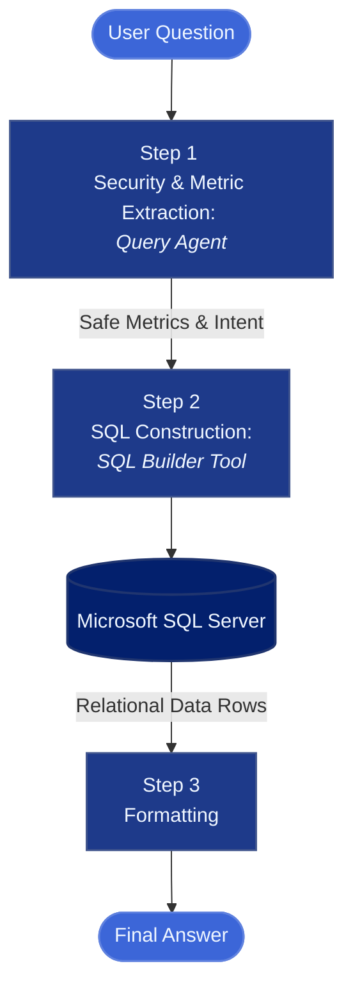

# Sports Day NLP-to-SQL Query System

[](https://mastra.ai/)
[](https://www.microsoft.com/sql-server)
[](https://developer.mozilla.org/en-US/docs/Web/JavaScript)

A streamlined, agent-based AI workflow designed to process natural language queries regarding school sports day statistics. The architecture uses a dedicated AI agent to sanitize inputs and extract query metrics, delegating the complex SQL formulation (including multi-table joins) to a specialized database tool.

---

> [!NOTE]
> ### TL;DR
> * **What it is:** A backend service that answers user questions about a school's sports day using natural language to SQL translation.
> * **How it works:** An agent validates user intent to prevent malicious queries, extracts parameters, and passes them to a SQL building tool.
> * **Architecture:** A direct Agent-to-Tool pipeline securely querying a 3-table relational SQL Server database.
> * **Tech Stack:** Mastra, Node.js, Microsoft SQL Server, JavaScript.

---

## Architecture Overview

The system executes a safe, sequential pipeline to ensure that users can only extract permitted data without risking SQL injection or out-of-scope database operations:



---

## Pipeline Workflow Details

### 1. Security & Metric Extraction Phase
* **Component**: `Query Agent`
* **Objective**: Acts as the gatekeeper for user inputs and extracts structural metrics for data retrieval.
* **Mechanism**: Evaluates the raw natural language question for prompt injection or malicious intent. Once validated, it analyzes the prompt to identify key metrics and formats them into a structured payload for the downstream tool.

### 2. Deterministic SQL Formulation
* **Component**: `SQL Builder Tool`
* **Objective**: Safely translates agent-provided metrics into executable SQL Server queries.
* **Mechanism**: Utilizes internal functions to map the structured metrics to the correct database schema. It automatically handles the necessary `JOIN` operations across the `Events`, `Students`, and `Participation` tables to fulfill the data request accurately.

---

## Database Schema Reference

The system reads from a normalized SQL Server database containing three core tables to track sports day events:

### 1. `dbo.Events`
Stores all track, field, and team events held during the sports day.
* `event_id` (PK): Unique identifier for the event.
* `event_name`: The specific name of the competition.
* `school_level`, `min_grade`, `max_grade`: Grade and school level restrictions for participants.
* `category`, `gender_category`: Classification and gender divisions.
* `event_date`: Date the event takes place.
* `points_first`, `points_second`, `points_third`: Point values awarded for podium finishes.

### 2. `dbo.Students`
Maintains the master roster of all students in the school.
* `student_id` (PK): Unique student identifier.
* `first_name`, `last_name`: Student's full name.
* `grade`, `school_level`: Academic placement.
* `house_team`: The faction or team the student represents.

### 3. `dbo.Participation`
A junction table linking students to the events they competed in and tracking performance.
* `participation_id` (PK): Unique record identifier.
* `student_id` (FK): Reference to `dbo.Students`.
* `event_id` (FK): Reference to `dbo.Events`.
* `podium_position`: The student's final placement.
* `score_or_time`: Text representation of the exact time or score.
* `points_awarded`: Points contributed to their house team.


---

## Quickstart

```bash
# 1. Clone repository
git clone [https://github.com/your-username/sports-day-sql-agent.git](https://github.com/your-username/sports-day-sql-agent.git)
cd sports-day-sql-agent

# 2. Install dependencies
npm install

# 3. Add your environment credentials in .env (DB connection + API keys)

# 4. Start the application
npm run dev
```

---

Core workflow logic, tools, and agents reside inside src/mastra/
